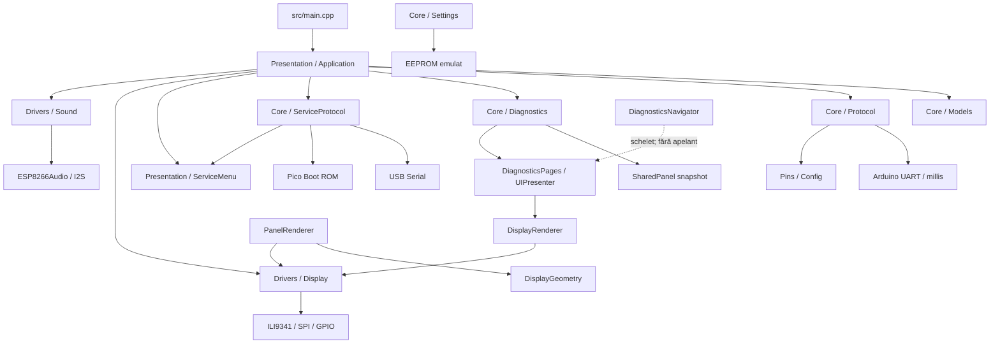

# Audit și inventariere `src/`

## Scop și context

Inventarul acoperă cele 43 de fișiere C++ (`.h` și `.cpp`) din `src/`. Proiectul este configurat în PlatformIO pentru placa Marble bazată pe Raspberry Pi Pico, cu framework Arduino și core-ul `earlephilhower`. Auditul este static; nu implică modificări de cod sau validare prin build.

## Inventarul modulelor

| Zonă | Fișiere | Responsabilitate |
|---|---|---|
| Intrare aplicație | [`src/main.cpp`](src/main.cpp) | Inițializează setările, aplicația și protocolul/meniul de service; rulează ciclurile pentru Core 0 și Core 1. |
| Modele și configurare | [`SharedPanel.h`](src/Core/Models/SharedPanel.h), [`SharedPanel.cpp`](src/Core/Models/SharedPanel.cpp), [`Config.h`](src/Core/Models/Config.h), [`Pins.h`](src/Core/Models/Pins.h), [`BuildInfo.h`](src/Core/Models/BuildInfo.h), [`Changelog.h`](src/Core/Models/Changelog.h), [`Images.h`](src/Core/Models/Images.h) | Tipuri pentru starea liftului, UI și sistem; memoria partajată; parametri de instalație și hardware; pini; date de build, istoric și asset-uri. `SharedPanel.cpp` implementează accesul sincronizat la memoria partajată. |
| Servicii | [`Diagnostics.h`](src/Core/Services/Diagnostics.h), [`Diagnostics.cpp`](src/Core/Services/Diagnostics.cpp), [`DiagnosticsPages.h`](src/Core/Services/DiagnosticsPages.h), [`DiagnosticsPages.cpp`](src/Core/Services/DiagnosticsPages.cpp), [`Protocol.h`](src/Core/Services/Protocol.h), [`Protocol.cpp`](src/Core/Services/Protocol.cpp), [`Settings.h`](src/Core/Services/Settings.h), [`Settings.cpp`](src/Core/Services/Settings.cpp), [`ServiceProtocol.h`](src/Core/Services/ServiceProtocol.h), [`ServiceProtocol.cpp`](src/Core/Services/ServiceProtocol.cpp), [`Presentation.h`](src/Core/Services/Presentation.h), [`Presentation.cpp`](src/Core/Services/Presentation.cpp) | Interpretarea stării pentru diagnosticare; construirea paginilor de diagnostic; protocolul de comunicație cu liftul; setări persistente; comenzi pentru Service Box; adaptor pentru actualizarea display-ului. |
| Drivere | [`Display.h`](src/Drivers/Display.h), [`Display.cpp`](src/Drivers/Display.cpp), [`DisplayGeometry.h`](src/Drivers/DisplayGeometry.h), [`DisplayGeometry.cpp`](src/Drivers/DisplayGeometry.cpp), [`Sound.h`](src/Drivers/Sound.h), [`Sound.cpp`](src/Drivers/Sound.cpp), [`Leds.h`](src/Drivers/Leds.h), [`Leds.cpp`](src/Drivers/Leds.cpp), [`Alerts.h`](src/Drivers/Alerts.h) | Acces la TFT/SPI și primitive de desenare; metrici și geometrie de text; audio I2S; interfață LED; resurse pentru alerte. Implementarea LED este momentan fără efect. |
| Prezentare și orchestrare | [`Application.h`](src/Presentation/Application.h), [`Application.cpp`](src/Presentation/Application.cpp), [`PanelRenderer.h`](src/Presentation/PanelRenderer.h), [`PanelRenderer.cpp`](src/Presentation/PanelRenderer.cpp), [`DisplayRenderer.h`](src/Presentation/DisplayRenderer.h), [`DisplayRenderer.cpp`](src/Presentation/DisplayRenderer.cpp), [`UIPresenter.h`](src/Presentation/UIPresenter.h), [`UIPresenter.cpp`](src/Presentation/UIPresenter.cpp), [`DiagnosticsNavigator.h`](src/Presentation/DiagnosticsNavigator.h), [`DiagnosticsNavigator.cpp`](src/Presentation/DiagnosticsNavigator.cpp), [`ServiceMenu.h`](src/Presentation/ServiceMenu.h), [`ServiceMenu.cpp`](src/Presentation/ServiceMenu.cpp), [`UITheme.h`](src/Presentation/UITheme.h), [`TextWidget.h`](src/Presentation/TextWidget.h) | Orchestrarea aplicației pe nuclee; randarea ecranului principal și a paginilor de diagnostic; construirea modelelor UI; traducerea cheilor UI; meniul de service și navigare; starea de desenare a textului. |

## Responsabilități și dependențe

`Application::init()` este unicul proprietar al inițializării `ServiceProtocol` și `ServiceMenu`, alături de serviciile pe care le pornește explicit. `main.cpp` inițializează mai întâi `Settings` (necesar înainte de inițializarea sunetului), apoi pornește `Application` și deleagă ciclurile celor două nuclee. Astfel, punctul de intrare nu mai depinde de componentele concrete de service.

Responsabilitățile ciclice sunt împărțite astfel:

| Nucleu | Responsabilitate | Componente accesate |
|---|---|---|
| Core 0 | Poll pentru comenzile USB Service Box; actualizarea meniului de service; citirea snapshot-ului; actualizarea stării de prezentare și randarea ecranului normal/diagnostic. | `ServiceProtocol`, `ServiceMenu`, `Presentation`, `DiagnosticsNavigator`, `Diagnostics`, `UIPresenter`, `PanelRenderer`, `DisplayRenderer`. |
| Core 1 | Citirea snapshot-ului precedent; actualizarea protocolului liftului și stării; declanșarea efectelor sonore; actualizarea uptime-ului; publicarea snapshot-ului nou. | `Protocol`, `Sound`, `SharedPanel`, intrarea GPIO overload. |

`Application` rămâne coordonatorul fluxului și al ordinii apelurilor. `Settings` se inițializează din `main.cpp` înaintea sa deoarece configurația persistentă este citită de componentele pornite de `Application`.

### Fluxul de date între nuclee

Core 1 este unicul scriitor ciclic al `gSharedMemory`: citește snapshot-ul valid, îl actualizează prin `Protocol`/logica sistemului și îl publică cu `shared_panel_write()`. Core 0 și componentele de service doar citesc snapshot-uri prin `shared_panel_read()` și nu publică modificări în această structură. La pornire, `Application::init()` publică valorile inițiale înainte de începerea ciclurilor. Funcțiile de acces folosesc secvența `seq` și bariere de memorie pentru a evita consumarea unui snapshot scris concurent; o citire nereușită după reîncercări abandonează iterația curentă.

Fluxul principal este, așadar: **Core 1: Protocol/GPIO/timp → snapshot local → `gSharedMemory` → Core 0: snapshot local → Presentation/diagnostic → display**. Comenzile Service Box circulă separat pe Core 0 prin USB către `ServiceProtocol` și `ServiceMenu`; ele nu folosesc `SharedPanel` ca mecanism de comandă între nuclee.

Separarea de mai sus clarifică proprietatea datelor, dar nu face `Application` independent de hardware: acesta coordonează explicit servicii și randere necesare funcționalității. Includerile directe nefolosite și inițializările duplicate au fost eliminate din `main.cpp`; eliminarea dependențelor funcționale din `Application` ar necesita un contract nou pentru task-uri sau prezentare, nu doar mutarea apelurilor în wrappere.

Fluxul principal al diagnosticelor este: snapshot din `SharedPanel` → interpretare în `Diagnostics` → structurarea paginii prin `UIPresenter`/`DiagnosticsPages` → randare prin `DisplayRenderer` → primitivele driverului `Display`. Ecranul principal este randat separat de `PanelRenderer`, care folosește `DisplayGeometry` și fonturile din `Fonts/`.

### Cuplaje importante

- `Application` citește GPIO-ul de overload și apelează direct `Display`, `Sound`, `Protocol` și componentele de prezentare.
- `Protocol.cpp` amestecă recepția UART cu delimitarea cadrelor, CRC-ul, parsarea și validarea semantică. Algoritmii de parsare pot fi extrași, dar modulul actual depinde de `HardwareSerial`, `millis()`, `Pins` și `Config`.
- `Settings.cpp` folosește EEPROM-ul emulat al platformei Arduino-Pico. Validarea datelor și CRC-ul sunt logică generală, dar stratul de persistență nu este portabil ca atare.
- `ServiceProtocol.cpp` folosește USB Serial și API-ul Pico Boot ROM și este cuplat la `Protocol`, `Settings`, `Sound` și `ServiceMenu`.
- `Display.cpp` depinde de ILI9341, SPI, GPIO, imagini și fonturi. `DisplayGeometry` folosește Adafruit GFX și `GFXfont`; geometria este separată conceptual, dar nu independentă de biblioteca grafică.
- `PanelRenderer` și `DisplayRenderer` apelează API-ul concret `Display`; înlocuirea ecranului sau a bibliotecii poate necesita adaptări în prezentare.
- `SharedPanel.h` este un contract de date simplu, însă `SharedPanel.cpp` folosește bariere ARM (`dmb`) și presupune acces multicore compatibil cu hardware-ul curent.

## Reutilizare

| Nivel | Funcționalități | Condiții |
|---|---|---|
| Reutilizabile direct | Tipurile și enum-urile din `SharedPanel.h`; interpretarea din `Diagnostics.cpp`; dicționarul de chei din `UITheme.h`. | Schema de date și semnificația stărilor liftului rămân aceleași. |
| Reutilizabile conceptual, cu dependențe păstrate | Structurile logice `PageModel`/`PageLine`; algoritmii CRC și parsarea payload-ului; calculele din `DisplayGeometry`; fonturile și imaginile. | `DiagnosticsPages.cpp` folosește și `millis()`/`gSharedMemory`; protocolul include transportul UART; geometria și asset-urile cer Adafruit GFX și formatele existente. |
| Necesită adaptare pentru alt hardware/platformă | Driverele `Display`, `Sound`, `Leds`; sincronizarea din `SharedPanel.cpp`; UART/protocolul, EEPROM-ul, Service Mode și orchestrarea `Application`. | Sunt legate de placa Marble/Pico, de framework-ul Arduino și/sau de perifericele actuale. |

Nu rezultă un subsistem complet de UI portabil fără modificări: modelele și interpretarea sunt cele mai reutilizabile, în timp ce randarea și fluxurile operaționale ajung la API-uri concrete de hardware.

## Observații de audit

1. Rezolvat: `Application::init()` deține inițializarea `ServiceProtocol` și `ServiceMenu`; `main.cpp` nu le mai inițializează separat.
2. `DiagnosticsNavigator::updateButtons()` este gol și nu are apelant în `src/`; navigarea diagnosticelor pare neimplementată în starea curentă.
3. `Leds.cpp` conține implementări vide, iar în `src/` nu există apeluri către `Leds`.
4. Modelul logic al paginilor este mai abstract decât randerele, însă implementarea `DiagnosticsPages.cpp` include acces la timp și la memoria globală pentru paginile de developer.

## Verificare

Audit static al fișierelor sursă și al dependențelor directe; build-ul PlatformIO este folosit pentru verificarea modificării, fără verificare comportamentală pe placă.