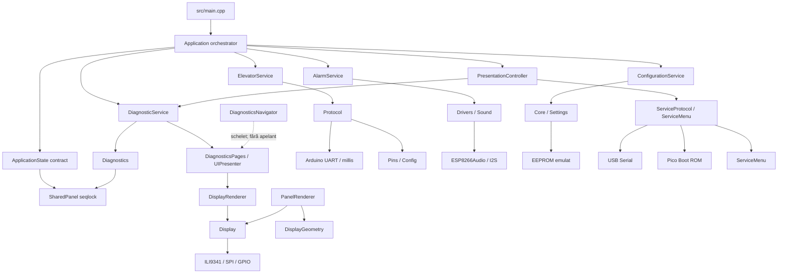

# Audit și inventariere `src/`

## Scop și context

Inventarul acoperă 53 de fișiere C++ (`.h` și `.cpp`) din `src/`. Proiectul este configurat în PlatformIO pentru placa Marble bazată pe Raspberry Pi Pico, cu framework Arduino și core-ul `earlephilhower`. Refactorul a fost verificat prin build PlatformIO pentru mediul `marble`; nu s-a făcut verificare comportamentală pe placă.

## Inventarul modulelor

| Zonă | Fișiere | Responsabilitate |
|---|---|---|
| Intrare aplicație | [`src/main.cpp`](src/main.cpp) | Pornește serialul, aplicația și ciclurile pentru Core 0 și Core 1. |
| Modele și configurare | [`SharedPanel.h`](src/Core/Models/SharedPanel.h), [`SharedPanel.cpp`](src/Core/Models/SharedPanel.cpp), [`Config.h`](src/Core/Models/Config.h), [`Pins.h`](src/Core/Models/Pins.h), [`BuildInfo.h`](src/Core/Models/BuildInfo.h), [`Changelog.h`](src/Core/Models/Changelog.h), [`Images.h`](src/Core/Models/Images.h) | Tipuri pentru starea liftului, UI și sistem; snapshot partajat expus prin contractul `ApplicationState`; parametri de instalație și hardware; pini; date de build, istoric și asset-uri. |
| Servicii | [`Diagnostics.h`](src/Core/Services/Diagnostics.h), [`Diagnostics.cpp`](src/Core/Services/Diagnostics.cpp), [`DiagnosticService.h`](src/Core/Services/DiagnosticService.h), [`DiagnosticService.cpp`](src/Core/Services/DiagnosticService.cpp), [`DiagnosticsPages.h`](src/Core/Services/DiagnosticsPages.h), [`DiagnosticsPages.cpp`](src/Core/Services/DiagnosticsPages.cpp), [`Protocol.h`](src/Core/Services/Protocol.h), [`Protocol.cpp`](src/Core/Services/Protocol.cpp), [`ElevatorService.h`](src/Core/Services/ElevatorService.h), [`ElevatorService.cpp`](src/Core/Services/ElevatorService.cpp), [`AlarmService.h`](src/Core/Services/AlarmService.h), [`AlarmService.cpp`](src/Core/Services/AlarmService.cpp), [`ConfigurationService.h`](src/Core/Services/ConfigurationService.h), [`ConfigurationService.cpp`](src/Core/Services/ConfigurationService.cpp), [`Settings.h`](src/Core/Services/Settings.h), [`Settings.cpp`](src/Core/Services/Settings.cpp), [`ServiceProtocol.h`](src/Core/Services/ServiceProtocol.h), [`ServiceProtocol.cpp`](src/Core/Services/ServiceProtocol.cpp), [`Presentation.h`](src/Core/Services/Presentation.h), [`Presentation.cpp`](src/Core/Services/Presentation.cpp) | Servicii de lift, alarmă, diagnosticare și configurare; interpretarea și construirea paginilor de diagnostic; protocolul de comunicație cu liftul; configurare persistentă; comenzi Service Box; adaptor pentru actualizarea display-ului. |
| Drivere | [`Display.h`](src/Drivers/Display.h), [`Display.cpp`](src/Drivers/Display.cpp), [`DisplayGeometry.h`](src/Drivers/DisplayGeometry.h), [`DisplayGeometry.cpp`](src/Drivers/DisplayGeometry.cpp), [`Sound.h`](src/Drivers/Sound.h), [`Sound.cpp`](src/Drivers/Sound.cpp), [`Leds.h`](src/Drivers/Leds.h), [`Leds.cpp`](src/Drivers/Leds.cpp), [`Alerts.h`](src/Drivers/Alerts.h) | Acces la TFT/SPI și primitive de desenare; metrici și geometrie de text; audio I2S; interfață LED; resurse pentru alerte. Implementarea LED este momentan fără efect. |
| Prezentare și orchestrare | [`Application.h`](src/Presentation/Application.h), [`Application.cpp`](src/Presentation/Application.cpp), [`PresentationController.h`](src/Presentation/PresentationController.h), [`PresentationController.cpp`](src/Presentation/PresentationController.cpp), [`PanelRenderer.h`](src/Presentation/PanelRenderer.h), [`PanelRenderer.cpp`](src/Presentation/PanelRenderer.cpp), [`DisplayRenderer.h`](src/Presentation/DisplayRenderer.h), [`DisplayRenderer.cpp`](src/Presentation/DisplayRenderer.cpp), [`UIPresenter.h`](src/Presentation/UIPresenter.h), [`UIPresenter.cpp`](src/Presentation/UIPresenter.cpp), [`DiagnosticsNavigator.h`](src/Presentation/DiagnosticsNavigator.h), [`DiagnosticsNavigator.cpp`](src/Presentation/DiagnosticsNavigator.cpp), [`ServiceMenu.h`](src/Presentation/ServiceMenu.h), [`ServiceMenu.cpp`](src/Presentation/ServiceMenu.cpp), [`UITheme.h`](src/Presentation/UITheme.h), [`TextWidget.h`](src/Presentation/TextWidget.h) | `Application` inițializează serviciile și orchestrează ciclurile; `PresentationController` deține fluxul Core 0 și randarea; celelalte module construiesc și redau ecranul principal, diagnosticarea și meniul de service. |

## Responsabilități și dependențe

`Application::init()` inițializează `ConfigurationService`, `AlarmService`, `ElevatorService`, `DiagnosticService` și `PresentationController`. `ConfigurationService` inițializează `Settings` înaintea driverului audio; controller-ul inițializează `ServiceProtocol` și `ServiceMenu`. `main.cpp` rămâne un entrypoint subțire, care pornește aplicația și deleagă ciclurile celor două nuclee.

Responsabilitățile ciclice sunt împărțite astfel:

| Nucleu | Responsabilitate | Componente accesate |
|---|---|---|
| Core 0 | `Application` deleagă la `PresentationController`, care procesează comenzile USB, meniul de service, starea de afișare și randarea normală/de diagnostic. | `PresentationController`, `ServiceProtocol`, `ServiceMenu`, `Presentation`, `DiagnosticService`, rendererele și `ApplicationState`. |
| Core 1 | `Application` citește starea, orchestrează actualizarea liftului și alarmelor, actualizează uptime-ul și publică snapshot-ul nou. | `ElevatorService`, `AlarmService`, `ApplicationState`, intrarea GPIO overload. |

`Application` rămâne coordonatorul fluxului și al ordinii apelurilor. `ConfigurationService` inițializează configurația persistentă înaintea serviciilor care o folosesc.

### Fluxul de date între nuclee

Core 1 este unicul scriitor ciclic al stării: citește snapshot-ul stabil, actualizează liftul și alarmele prin servicii și îl publică prin contractul `ApplicationState`. Core 0 și componentele de service citesc prin același contract. La pornire, `Application::init()` publică starea inițială. Implementarea folosește secvența `seq` și bariere de memorie pentru a evita consumarea unui snapshot scris concurent; o citire nereușită după reîncercări abandonează iterația. Stocarea internă nu mai este expusă direct; paginile de developer primesc adresa și secvența prin API-ul de diagnostic al stării.

Fluxul principal este, așadar: **Core 1: `ElevatorService`/`AlarmService`/timp → snapshot local → `ApplicationState` → Core 0: `PresentationController`/diagnostic → display**. Comenzile Service Box circulă separat pe Core 0 prin USB către `ServiceProtocol` și `ServiceMenu`; ele nu folosesc snapshot-ul ca mecanism de comandă între nuclee.

`Application` nu mai conține logică de desenare și nu apelează direct driverele UI. Serviciile expun contractele funcționale pentru lift, alarme, diagnosticare și configurare; controller-ul de prezentare deține fluxul UI. `SharedPanel` rămâne necesar pentru schimbul sincronizat de snapshot-uri între nuclee, iar accesul la memoria sa este centralizat în `ApplicationState`.

Fluxul principal al diagnosticelor este: snapshot din `SharedPanel` → interpretare în `Diagnostics` → structurarea paginii prin `UIPresenter`/`DiagnosticsPages` → randare prin `DisplayRenderer` → primitivele driverului `Display`. Ecranul principal este randat separat de `PanelRenderer`, care folosește `DisplayGeometry` și fonturile din `Fonts/`.

### Cuplaje importante

- `Application` coordonează ciclurile; `PresentationController` deține desenarea și fluxul UI.
- `SharedPanel` este necesar în forma actuală: Core 1 publică, iar Core 0 citește concurent. `ApplicationState` centralizează contractul de acces și ascunde bufferul seqlock.
- `Protocol.cpp` amestecă recepția UART cu delimitarea cadrelor, CRC-ul, parsarea și validarea semantică. Algoritmii de parsare pot fi extrași, dar modulul actual depinde de `HardwareSerial`, `millis()`, `Pins` și `Config`.
- `Settings.cpp` folosește EEPROM-ul emulat al platformei Arduino-Pico. Validarea datelor și CRC-ul sunt logică generală, dar stratul de persistență nu este portabil ca atare.
- `ServiceProtocol.cpp` folosește USB Serial și API-ul Pico Boot ROM; comenzile de domeniu sunt delegate către `ElevatorService`, `ConfigurationService` și `AlarmService`, iar modul service către `ServiceMenu`.
- `Display.cpp` depinde de ILI9341, SPI, GPIO, imagini și fonturi. `DisplayGeometry` folosește Adafruit GFX și `GFXfont`; geometria este separată conceptual, dar nu independentă de biblioteca grafică.
- `PanelRenderer` și `DisplayRenderer` apelează API-ul concret `Display`; înlocuirea ecranului sau a bibliotecii poate necesita adaptări în prezentare.
- `SharedPanel.h` este un contract de date simplu, însă `SharedPanel.cpp` folosește bariere ARM (`dmb`) și presupune acces multicore compatibil cu hardware-ul curent.

## Reutilizare

| Nivel | Funcționalități | Condiții |
|---|---|---|
| Reutilizabile direct | Tipurile și enum-urile din `SharedPanel.h`; interpretarea din `Diagnostics.cpp`; dicționarul de chei din `UITheme.h`. | Schema de date și semnificația stărilor liftului rămân aceleași. |
| Reutilizabile conceptual, cu dependențe păstrate | Structurile logice `PageModel`/`PageLine`; algoritmii CRC și parsarea payload-ului; calculele din `DisplayGeometry`; fonturile și imaginile. | `DiagnosticsPages.cpp` folosește și `millis()`; protocolul include transportul UART; geometria și asset-urile cer Adafruit GFX și formatele existente. |
| Necesită adaptare pentru alt hardware/platformă | Driverele `Display`, `Sound`, `Leds`; sincronizarea din `SharedPanel.cpp`; UART/protocolul, EEPROM-ul, Service Mode și orchestrarea `Application`. | Sunt legate de placa Marble/Pico, de framework-ul Arduino și/sau de perifericele actuale. |

Nu rezultă un subsistem complet de UI portabil fără modificări: modelele și interpretarea sunt cele mai reutilizabile, în timp ce randarea și fluxurile operaționale ajung la API-uri concrete de hardware.

## Observații de audit

1. Rezolvat: `Application` este orchestrator fără responsabilități de desenare; logica UI este în `PresentationController`.
2. Rezolvat: serviciile de lift, alarmă, diagnosticare și configurare au contracte separate; `ApplicationState` centralizează accesul la starea comună.
3. Confirmat: `SharedPanel` este necesar pentru snapshot-ul sincronizat Core 1 → Core 0 și păstrează seqlock-ul existent.
4. Rezolvat: contorul de boot este stocat la offset 256, fără să suprascrie zona setărilor EEPROM.
5. `DiagnosticsNavigator::updateButtons()` este gol și nu are apelant în `src/`; navigarea diagnosticelor pare neimplementată în starea curentă.
6. `Leds.cpp` conține implementări vide, iar în `src/` nu există apeluri către `Leds`.
7. Modelul logic al paginilor este mai abstract decât randerele; `DiagnosticsPages.cpp` folosește în continuare timpul pentru paginile de developer.

## Verificare

Audit static al fișierelor sursă și al dependențelor directe; build-ul PlatformIO pentru `marble` a trecut după separarea serviciilor. Nu s-a făcut verificare comportamentală pe placă.